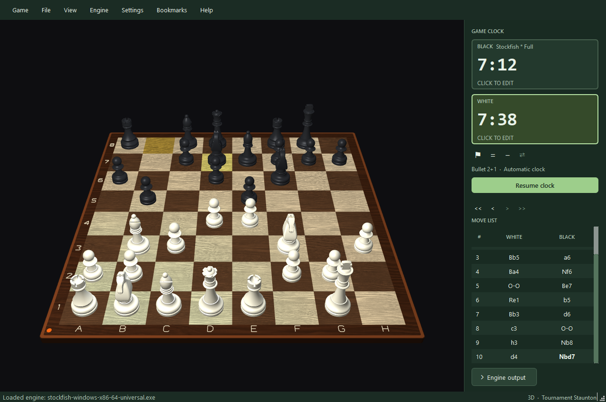

# OTBMaster3D

**Current project version: 1.8.4**

OTBMaster3D is an open-source Windows chess application for playing, analysing,
and organizing chess positions. It combines a Qt desktop interface, interactive
2D and 3D boards, UCI chess engines, PGN/FEN documents, bookmarks, and optional
online play through Lichess.

[Windows downloads](https://github.com/nork79/OTBMaster3D/releases) ·
[User guide](docs/user-guide.md) ·
[Engineering overview](docs/engineering.md) ·
[Source access](SOURCE_ACCESS.md) ·
[Changelog](CHANGELOG.md)



## Features

- Interactive 3D and flat 2D boards, multiple piece sets, board materials,
  themes, colors, sound profiles, camera controls, and move animations.
- Play against UCI engines, including Stockfish, Fairy-Stockfish, and Rodent IV.
  Engine difficulty and style controls are approximate and vary by engine.
- Engine analysis, move previews, position evaluation, captured material, and
  offline opening recognition.
- Automatic and over-the-board clocks, PGN/FEN import and export, move review,
  session recovery, and nested position bookmarks.
- Lichess sign-in with browser OAuth or a personal access token; direct player
  and bot challenges; bot discovery and profiles; Quick Pairing; live games;
  and **Game History** (`Lichess > Game History…`) to browse and load past
  Lichess games onto the board for replay or analysis.
  Online bot choices are ordered from lower to higher average available rating.
  During a live Lichess game, local engine play and analysis are disabled.

## Platform and installation

The current installer configuration targets **Windows 10 or later on x64** and
requires a graphics driver that supports OpenGL 2.1. Other operating systems are
not supported by the current packaging configuration.

For a prebuilt application, use the [GitHub Releases page](https://github.com/nork79/OTBMaster3D/releases).
Choose an installer and its matching source, dependency-source, and checksum
files from the same release. Check the version shown in **Help > About** against
the version in the release assets. The source and packaging metadata in this
checkout identify version 1.8.4.

The packaged application includes Python, Qt, assets, opening books, and the
supported engine resources. Setup requires Microsoft Visual C++ x64
Redistributable **14.44.35211.0 or newer**, installed separately from Microsoft;
the installer checks for it and displays Microsoft's download page if it is
missing. The installer is unsigned. See the [installer notes](docs/windows-installer.md)
for build and verification details.

## Run from source

Use 64-bit Python 3.13 on Windows. From the repository folder:

```powershell
py -3.13 -m venv .venv
.\.venv\Scripts\python.exe -m pip install -r requirements.txt
.\.venv\Scripts\python.exe main.py
```

The equivalent module entry point is `python -m otb_chess`. The pinned
`cozy-chess-py` dependency currently requires the Python 3.13 Windows wheel.
The regular application uses the Qt desktop interface; Tkinter is required by
the full test and installer-build setup. Stockfish and Fairy-Stockfish can be
installed into a source workspace with `tools/install_stockfish.py` and
`tools/install_fairy_stockfish.py`. Rodent IV setup additionally needs
MinGW-w64 `g++`; see [engine setup](engines/README.md). Engine installation is
optional if you want to play without an engine.

The source dependencies are pinned in [requirements.txt](requirements.txt):
GLFW 2.10.2, PyOpenGL 3.1.10, python-chess 1.11.2, cozy-chess-py 0.1.1,
Pillow 12.3.0, and PySide6 6.11.2. PyInstaller and Inno Setup are separate
installer-build tools, not runtime dependencies for launching from source.

## Basic use

Move by clicking a piece and destination square or by dragging. Use **View** to
switch board modes, flip the board, or reset the current view. Configure board,
piece, clock, sound, and interface preferences in **Settings**. Use **File** to
open or save PGN games and FEN positions. Add and organize saved positions with
the **Bookmarks** menu; bookmarks preserve position history when valid and do
not replace the current engine or clock settings when opened.

See the [user guide](docs/user-guide.md) for controls, clocks, engines, bookmarks,
Lichess, setup, and troubleshooting.

## Lichess requirements and limits

Lichess play requires an internet connection and a Lichess account. Sign in from
the **Lichess** menu with browser OAuth (PKCE) or a personal access token with
`board:play`, `challenge:read`, and `challenge:write` scopes. The app can issue
direct challenges to a username or an online bot, or search for a Quick Pairing
opponent using supported Rapid/Classical controls. It reports when a sent
challenge is accepted, declined, or cancelled; a pending sent challenge can be
cancelled from its dialog. Incoming challenges are not managed in the app; use
the Lichess website or client to accept or decline them.

Bot profile details and images depend on data and assets Lichess makes available.
If a bot is offline by the time a challenge is sent, or the connection fails,
the server may reject the request. A live game uses Lichess as the authoritative
source for moves and clocks. See [Lichess instructions and troubleshooting](docs/user-guide.md#lichess-online-play).

## Tests and CI

Windows CI is configured for Python 3.13. One job runs syntax checks and tests
that do not need a graphics context; another installs Stockfish and
Fairy-Stockfish and runs live engine integration tests. The full local suite also
contains native Qt/OpenGL and Tk tests, which need a suitable Windows desktop.
To create the dedicated test environment and run discovery:

```powershell
powershell -NoProfile -File tools/setup_test_env.ps1 -Python C:\path\to\Python313\python.exe
.\.venv-test\Scripts\python.exe -m unittest discover -s tests -v
```

See [contribution and test instructions](CONTRIBUTING.md) for engine and graphics
test requirements. These instructions describe configured checks; they do not
claim that the current checkout's tests have been run.

## Project structure and licensing

`main.py` launches the Qt application. `otb_chess/ui` contains the desktop UI,
`otb_chess/core` owns game and clock coordination, `otb_chess/services` contains
settings, engines, bookmarks, persistence, and Lichess integration, and
`otb_chess/graphics` renders the board. Production chess rules, notation, UCI,
and opening-book adapters live in `otb_chess/chess_backend` and currently use
python-chess. The separate `otb_chess_core` package is experimental and is not
the production rules provider. See the [engineering overview](docs/engineering.md).

Original application code is licensed under **GPL-3.0-only**. Third-party engines,
libraries, and assets retain their own licences. See [LICENSE](LICENSE),
[copyright information](COPYRIGHT.md), [third-party notices](THIRD_PARTY_NOTICES.md),
and [third-party licences](THIRD_PARTY_LICENSES.md). The app has no activation
or paid feature unlocks.
